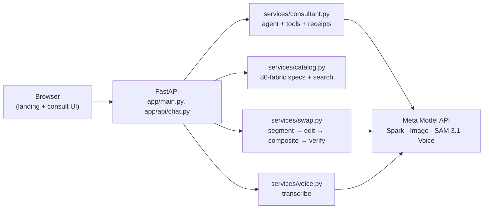

# ReCover — see your own furniture in a new fabric

> **"Change the look, not the furniture."**

ReCover is an AI upholstery consultant: photograph your sofa, describe
your home (kids, cats, sun, budget) in any language, and see your own
furniture reupholstered on screen — then reupholster instead of replacing.

## The problem

Most sofas are thrown out for their fabric, not their frame:

- **12.1M** tons of furniture thrown away in the US in one year
  (US EPA, 2018); **~80%** of it ends up in landfill (US EPA, 2018).
- **10M+** tonnes of furniture discarded each year in the EU
  (EEB, 2017).
- **≈52 kg of CO₂e avoided per reupholstered 3-seat sofa**
  (sourced: EPD NEPD-1805-759, Helland Duun 3-seater, A1–A3
  manufacturing; other pieces scale by weight class).

Reupholstering gives a good frame another ten years and keeps bulk
waste down. ReCover removes the two reasons people replace instead:
not knowing which fabric survives their home, and not being able to
picture the result.

## What it does

- **Consultant flow** — a real multi-turn agent (never a fixed
  questionnaire) that learns the piece, room, style, users and budget
  one question at a time, in the customer's language.
- **Room analysis** — upload a photo (or pick a sample room) and get
  room type, style, light level, detected piece and a wall-color
  palette.
- **Grounded recommendations** — exactly 3 fabrics per turn, every code
  validated against this turn's catalog search; receipts show what
  matched (`✓ Pet-friendly`) and what was relaxed (`⚠ 155 SAR/m —
  5 over budget`), with real numbers, never vague claims. If the model
  fumbles the codes, it retries against the exact valid list; if that
  fails, a deterministic top-3 fallback kicks in — a recommendation
  turn never comes back empty.
- **Voice in any language** — hold-to-talk transcription; the text
  flows through the same chat path, so language detection is unchanged.
- **Live language switching (5 live)** — English, العربية, हिन्दी,
  Français, Español across chat, voice and UI, with RTL for Arabic.
- **Part-accurate swap** — SAM 3.1 segments the piece, Muse Image
  reupholsters only that region, the result is composited back with a
  feathered edge (rest of the room pixel-identical), and Spark verifies
  color/pattern/scale, retrying once below 7/10. Live per-step progress.
- **Previews + compare** — every swap is stored per session (refresh
  safe), with a before/after slider, match badge and side-by-side
  compare.
- **Sample rooms** — living room, curtains room, Saudi majlis and
  armchair photos to try instantly (`/consult?sample=living`).
- **Multi-object assignment** — tap a region or chip to choose sofa,
  cushions or curtains; "Apply to all" renders every item in parallel
  from the original photo (per-item 60 s budget, failed items retried
  once then skipped with a note) and composites them largest-first.
- **Meters + quote + handoff** — yardage table (137 cm width, +15% for
  patterned repeats, curtains measured or "needs measurements"),
  per-item quote in SAR with a "preliminary estimate" label, and a
  "Send to upholsterer" WhatsApp deep link with a public 14-day
  HMAC-signed preview link (`/share/<token>.jpg`, exempt from the
  demo lock, unguessable, noindex).
- **Desktop parity** — the full mobile journey (outlines, target-named
  Try buttons, single result bubble, summary card) works at
  1440×900 in Chromium and WebKit.

## Meta models used

| Model | Role | File |
|---|---|---|
| `muse-spark-1.3` | Consultant agent, room vision, swap verify, catalog verify/tagging | `app/services/consultant.py`, `scripts/verify_catalog.py`, `scripts/tag_snag_risk.py` |
| `muse-image-1.0` | Catalog swatches, sample rooms, fabric edit in swaps | `scripts/generate_images.py`, `scripts/generate_samples.py`, `app/services/swap.py` |
| `sam-3.1` | Piece segmentation for swaps (own lossless codec) | `app/services/sam_codec.py`, `app/services/swap.py` |
| `muse-voice-transcribe-1.0` | Voice input transcription | `app/services/voice.py` |
| `meta-models/muse-spark-open-1026` (Baseten) | Fallback consultant chat + off-topic scope guard, behind `SPARK_OPEN_FALLBACK=1` (needs `BASETEN_API_KEY`; not in the Modal deploy yet) | `app/services/consultant.py`, `tests/test_baseten.py` |

## Architecture



Two pages, no build step: `/` serves `app/static/landing.html`,
`/consult` serves the consultant app (`app/static/index.html`).
Streaming chat and swap progress run over SSE.

## Quality

- **Unit tests** — 255 tests (`tests/`): grounding fallback,
  receipts honesty, streaming fences, swap composite/codec, voice,
  multi-object assignment, meterage/quote, sourced CO₂, WhatsApp
  mapping, Baseten fallback, swap fabric meta, twin-bubble
  coalescing/refresh, share-link volume wait, room-image retry,
  5-language target matching + scope guard + server lines, plus
  headless WebKit (iPhone 15 Pro, EN+AR) chat and overflow suites and
  desktop parity (`scripts/desktop_e2e.py`, Chromium + WebKit) and
  5-language live (`scripts/lang_e2e.py`, HI/FR/ES) drivers.
- **Scenario eval** — `scripts/eval_scenarios.py` + `data/scenarios.json`
  (22 scripted multi-turn scenarios incl. Arabic/Hindi/French/Spanish
  replies, off-topic guarding, multi-object photo turns and meterage
  questions in EN+AR). Last full run: **20/22** (2 known model-side
  misses, 0 errors).
- **Self-correcting catalog loop** — every swatch is vision-scored
  against its spec; weak prompts are rewritten and regenerated
  automatically (`scripts/fix_catalog.py`, log in `data/fix_log.json`).

## Demo Catalog

The 80 fabrics and their images were generated with Muse Image
(`muse-image-1.0`) from structured specs for this hackathon, then
verified and tagged with Muse Spark (material/color/pattern match,
snag risk for pet owners). In production, suppliers upload real fabric
photos and Muse Spark auto-builds the catalog — the pipeline already
supports that path.

## Run locally

```bash
python3 -m venv .venv && source .venv/bin/activate
pip install -r requirements.txt   # includes ffmpeg for voice notes
```

Create `.env` in the repo root (never commit it) with your key:

```bash
MODEL_API_KEY=<your key>
```

Then:

```bash
.venv/bin/python -m uvicorn app.main:app --port 8000
# open http://localhost:8000/ (landing) and /consult (app)
.venv/bin/python -m pytest tests/ -q
.venv/bin/python scripts/eval_scenarios.py
```

## Deploy (locked demo)

The demo runs locked on Modal — never public:

- `deploy/modal_app.py` serves the same FastAPI app via
  `@modal.asgi_app`.
- Image: `requirements.txt` + `ffmpeg`; catalog, samples, specs and
  UI are baked in.
- Runtime writes (uploads, swap results) go to a persistent
  `modal.Volume`; chat sessions stay on the warm container
  (`min_containers=1`, swap timeout 900s).
- Access lock (additive middleware — local dev and tests are
  unaffected): every route requires HTTP Basic Auth when `DEMO_LOCK=1`
  (constant-time credential compare), plus
  `X-Robots-Tag: noindex, nofollow` on all responses.

```bash
modal secret create recover-secrets MODEL_API_KEY=... DEMO_USER=... DEMO_PASS=...
modal deploy deploy/modal_app.py
```

## WhatsApp

The same consultant runs on the WhatsApp Cloud API — same catalog,
swap, voice, meterage and CO₂ services, no duplicated logic:

- Text → consultant turn (auto language, Saudi dialect for Arabic).
- Photo → same upload/normalize path, then room analysis + detection.
- Voice note → ffmpeg → 16 kHz mono wav → Muse Voice transcription.
- Chips → reply buttons (≤3) or a list; detected items → a list;
  each fabric → its swatch image + caption, then "Try it" buttons.
- "Try it" runs the real swap and returns the result image;
  "apply all" runs the multi-swap; "summary" sends the forwardable
  handoff block (items, meters, price, total, CO₂).
- `new` / `جديد` resets, `language` shows the language list.
- Sessions persist on the Volume (24 h TTL); Meta retries are
  deduped by message id; replies return 200 fast and process in a
  background thread.

Setup (Meta dashboard values in angle brackets — nothing secret goes
in code or git):

```bash
modal secret create recover-whatsapp WA_TOKEN=<token> \
  WA_PHONE_NUMBER_ID=<phone-number-id> WA_APP_SECRET=<app-secret> \
  WA_VERIFY_TOKEN=<any-string-you-choose>
```

Then subscribe the app to the `messages` webhook field with callback
URL `https://<your-modal-app-url>/webhook/whatsapp` and the same
verify token. Local simulator (fake payloads, prints outbound, no
real sends): `.venv/bin/python scripts/whatsapp_sim.py`.

## Built during the hackathon (Oct 26 – Nov 4, 2026)

ReCover was built end-to-end during the hackathon window: catalog +
self-correcting verification, consultant agent with expert
(pets/kids/fire/blackout) and scope rules, deterministic reply
language, voice input, part-accurate fabric swap, streaming chat,
Arabic/RTL UX, landing page with live metrics, and the eval suite —
each part committed as it started working. Later: 5-language journey
(EN/AR/HI/FR/ES) with full i18n parity, multi-object assignment with
parallel swap, meterage/quote/upholsterer handoff, sourced CO₂ impact,
public share links, desktop parity, WhatsApp bot behind a flag, and a
Baseten Spark Open fallback behind a flag.
