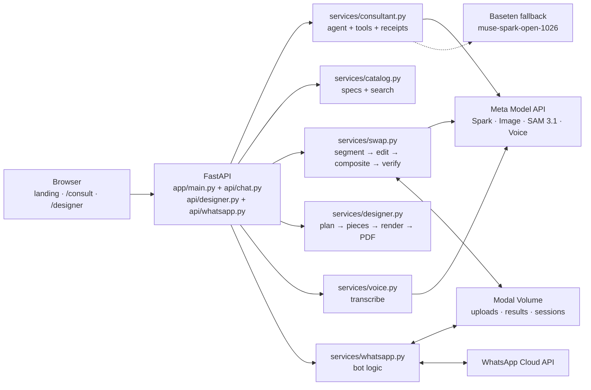

# ReCover — see your own furniture in a new fabric

**"Change the look, not the furniture."**

ReCover is an AI upholstery consultant. Photograph your sofa, describe your home (kids, cats, sun, budget) in any of five languages, and see **your own furniture reupholstered on screen**, with metres, a price, the CO₂ you avoid, and a one-tap handoff to your upholsterer. The goal is simple: reupholster instead of replacing.

Built solo for the Meta Global AI Developer Hackathon (Indie track), **100% on Meta models**: Muse Spark, Muse Image, SAM 3.1 and Muse Voice.

| | |
|---|---|
| 🎬 **Demo video (3 min)** | https://youtu.be/4s3Z4K4ewUc |
| 🌐 **Live demo** | https://moalaa2--recover-ai-web.us-east.modal.run/ |
| ⚡ **Fastest way to try it** | Open `/consult`, tap any **sample room**, then tap **"Just show me"** |

---

## Try it in 60 seconds (for judges)

1. Open the live demo.
2. Go to **`/consult`** and pick a sample room: *Living room, Sofa & pillows, Majlis, Armchair* or *Curtains*. These are pre-analysed, so they answer in seconds.
3. Tell the consultant something real, e.g. *"Two cats, I want something warm and durable, around $25 per metre"*, in English, العربية, हिन्दी, Français or Español, typed or spoken.
4. Tap **See it** on a recommendation. Your piece is reupholstered and everything else stays pixel-identical. Drag the before/after slider.
5. Select sofa + cushions + curtains and tap **Apply to all**.
6. Ask for **the quote**. You get metres per piece, price, CO₂ avoided and a **Send to upholsterer** WhatsApp link.
7. For designers, open **`/designer`**: upload a floor plan (PNG/JPG/PDF), assign fabrics per piece, and get a concept render plus a one-page client proposal PDF (EN/AR).

> **Please expect each render to take ~40–50 s.** That is three Meta models in sequence (segment → edit → verify), plus one automatic retry if the check fails. Uploading your own iPhone photo also works; the first analysis takes a little longer.

---

## The problem

Most sofas are thrown out for their **fabric**, not their frame:

- **12.1M tons** of furniture thrown away in the US in one year; **~80%** of it ends up in landfill (US EPA, 2018).
- **10M+ tonnes** of furniture discarded each year in the EU (EEB, 2017).
- **≈52 kg CO₂e** avoided per reupholstered 3-seat sofa (EPD NEPD-1805-759, Helland Duun 3-seater, A1–A3 manufacturing; other pieces scale by weight class).

Reupholstering gives a good frame another ten years. ReCover removes the two reasons people replace instead:

- they don't know **which fabric survives their home**;
- they **can't picture the result**.

## What it does

- **Consultant agent.** A real multi-turn tool-using agent, not a fixed questionnaire. It learns the piece, room, style, users and budget, one question at a time, in the customer's language.
- **Room analysis.** From a photo or a sample room, it reports room type, style, light level, the detected pieces (sofa / cushions / curtains / armchair) and a wall-colour palette.
- **Grounded recommendations.** Exactly 3 fabrics per turn. Every code is validated against this turn's catalog search, so codes are never invented.
  - Receipts show what matched (✓ Pet-friendly) and what was relaxed (⚠ $41/m, 5 over budget).
  - Fire-resistant requirements are never relaxed.
  - A deterministic top-3 fallback means a recommendation turn never comes back empty.
- **Voice in any language.** Hold-to-talk with Muse Voice, through the same chat path.
- **5 live languages.** English, العربية, हिन्दी, Français, Español across chat, voice and UI, with full RTL for Arabic.
- **Part-accurate swap.**
  - SAM 3.1 segments the piece.
  - Muse Image reupholsters only that region.
  - The result is composited back with a feathered edge, so the rest of the room is pixel-identical.
  - Muse Spark scores pattern and scale 0–10 (colour is decided by a deterministic ΔE gate); a score of 5 or lower triggers one corrective retry.
  - Coverage and old-fabric-residue checks reject bad composites.
- **Multi-object.** Sofa, cushions and curtains can each get their own fabric. **Apply to all** renders them in parallel (60 s per item) and layers them largest-first, cushions on top of the new sofa.
- **Previews + compare.** Every swap is stored per session and survives a refresh. Each one has a before/after slider and a match badge.
- **Metres → quote → handoff.**
  - Yardage uses 137 cm fabric, +15% for pattern repeats, curtains at 2.2× fullness, and cushions by count.
  - The per-item quote is in USD, labelled *preliminary estimate*.
  - CO₂ avoided comes with its EPD source.
  - **Send to upholsterer** opens a WhatsApp deep link with a 14-day HMAC-signed preview image.
- **Designer mode (`/designer`).**
  - Floor plan → detected pieces (editable boxes) → one fabric per piece → orthographic concept render.
  - Each piece gets a colour check, and you get a plan↔render before/after compare.
  - The output is a **one-page client proposal PDF** in English or Arabic, labelled "Concept render — not to scale".
- **Sample library.** 5 pre-analysed rooms (living room, sofa & pillows, Saudi majlis, armchair, curtains) for instant testing.
- **Desktop + mobile.** The full journey works on iPhone (WebKit) and on desktop (Chromium + WebKit, 1440×900).

## Meta models used

| Model | Role | Where |
|---|---|---|
| `muse-spark-1.3` | Consultant agent (tools, catalog search), room vision, swap verification, catalog verify/tagging, designer piece detection | `app/services/consultant.py`, `app/services/swap.py`, `scripts/verify_catalog.py` |
| `sam-3.1` | Piece segmentation for every swap | `app/services/sam_codec.py`, `app/services/swap.py` |
| `muse-image-1.0` | Fabric edit in swaps, designer concept render, catalog swatches, sample rooms | `app/services/swap.py`, `scripts/generate_images.py`, `scripts/generate_samples.py` |
| `muse-voice-transcribe-1.0` | Voice input (web + WhatsApp voice notes) | `app/services/voice.py` |
| `meta-models/muse-spark-open-1026` (Baseten) | Fallback consultant + off-topic scope guard (`SPARK_OPEN_FALLBACK=1`) | `app/services/consultant.py` |

No non-Meta models are used anywhere in the product.

## Architecture



Pages (`/`, `/consult`, `/designer`) stream chat and swap progress over SSE. Swap pipeline: SAM 3.1 mask → Muse Image edit on the masked region → feathered composite onto the original frame → Muse Spark verification → one retry if needed. Runtime files (uploads, swap results, sessions) live on a persistent Modal Volume.

## Honest limitations

- **Speed.** A render takes ~40–50 s; Apply-to-all with three pieces takes ~1–2 min.
- **Large patterns.** Bold patterns (stripes, honeycomb) can render at the wrong scale. Plain and small-weave fabrics are reliable.
- **Questions first.** The consultant asks a few questions before recommending. That is by design, but it occasionally exceeds a stated budget; the receipt line always shows by how much.
- **Designer render.** It is a *concept*: layout and fabrics match, but proportions can drift. It is labelled "not to scale".
- **WhatsApp bot.** It is fully implemented (see below), but going live is still pending the Meta dashboard callback + `messages` subscription. The web app's **Send to upholsterer** WhatsApp link works today.
- **Demo catalog.** It is AI-generated (see below). In production, suppliers upload real fabric photos.

## Demo catalog

The 80 fabrics and their images were generated with Muse Image from structured specs, then verified and tagged by Muse Spark (material/colour/pattern match, snag risk for pet owners). A self-correcting loop rewrites and regenerates weak swatches automatically (`scripts/fix_catalog.py`). In production, suppliers upload real fabric photos and Muse Spark auto-builds the catalog; the pipeline already supports that path.

## Quality

- **Unit + integration tests.** 472 passing (`tests/`). They cover:
  - grounding fallback and receipts honesty;
  - swap composite, coverage and residue checks;
  - voice, multi-object assignment, meterage and quote, sourced CO₂;
  - WhatsApp mapping, Baseten fallback, designer and proposal PDF;
  - 5-language matching.
- **Browser suites.** Headless WebKit (iPhone 15 Pro, EN + AR) and desktop parity (Chromium + WebKit).
- **Scenario eval.** `scripts/eval_scenarios.py` runs 22 scripted multi-turn scenarios (5 languages, off-topic guarding, multi-object, meterage). Last full run: 20/22.
- **Security review.**
  - Path traversal and share-token tampering are tested and rejected.
  - Upload size is capped at 25 MB.
  - Every response carries `noindex`.

## Run locally

```bash
python3 -m venv .venv && source .venv/bin/activate
pip install -r requirements.txt   # includes ffmpeg for voice notes
```

Create `.env` in the repo root (never commit it):

```
MODEL_API_KEY=<your key>
```

Then:

```bash
.venv/bin/python -m uvicorn app.main:app --port 8000
# open http://localhost:8000/ (landing), /consult (app), /designer
.venv/bin/python -m pytest tests/ -q
.venv/bin/python scripts/eval_scenarios.py
```

## Deploy

`deploy/modal_app.py` serves the same FastAPI app via `@modal.asgi_app`. Runtime writes go to a `modal.Volume`.

The demo is public: no login, just open the URL. Every response sets `X-Robots-Tag: noindex, nofollow`, and share previews stay signed (`/share/<token>.jpg`).

```bash
modal secret create recover-secrets MODEL_API_KEY=...
modal deploy deploy/modal_app.py
```

## WhatsApp

The same consultant runs on the WhatsApp Cloud API, using the same catalog, swap, voice, meterage and CO₂ services with no duplicated logic:

- **Text** → a consultant turn (auto language; Saudi dialect for Arabic).
- **Photo** → room analysis + detection.
- **Voice note** → ffmpeg → Muse Voice.
- **Chips and buttons.** Chips become reply buttons or lists. Each fabric is sent as a swatch image with a "Try it" button. **Try it** runs the real swap and returns the result image.
- **Commands.** `apply all` runs the multi-swap; `summary` sends the forwardable handoff block.
- **Sessions** persist on the Volume (24 h TTL). Retries are deduped by message id, and the webhook signature is verified.

Setup (nothing secret goes in code or git):

```bash
modal secret create recover-whatsapp WA_TOKEN=<token> \
  WA_PHONE_NUMBER_ID=<phone-number-id> WA_APP_SECRET=<app-secret> \
  WA_VERIFY_TOKEN=<any-string-you-choose>
```

Subscribe the app to the `messages` webhook field with callback `https://<your-modal-app-url>/webhook/whatsapp`. To test locally without real sends: `.venv/bin/python scripts/whatsapp_sim.py`.

## Built during the hackathon (Oct 26 – Nov 4, 2026)

ReCover was built end-to-end during the hackathon window by one developer. Each part was committed as it started working:

- the catalog and its self-correcting verification;
- the consultant agent with expert rules (pets, kids, fire, blackout) and scope guard;
- voice input;
- the part-accurate swap with verification;
- streaming chat;
- Arabic/RTL UX;
- the 5-language journey;
- multi-object Apply-to-all;
- metres, quote and upholsterer handoff;
- sourced CO₂;
- signed share links;
- desktop parity;
- Designer mode with the client proposal PDF;
- the WhatsApp bot;
- the Baseten Spark Open fallback;
- the eval suite.
